# My paint application

## REQUIREMENTS COMPLETED
### ✓ Bigger brush range
So, what I did here, ma'am, was change the brush size slider. Before, the biggest brush size was only 30.

Original:
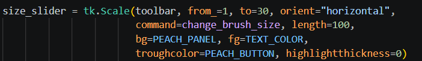
Revised:
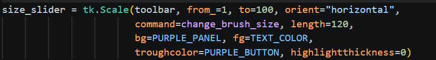

I changed from_=1 (thinnest line) to to=100 (thickest line).
When you move the slider, change_brush_size updates brush_size. Both the screen and the saved image stay 900x550, so the saved picture matches what you draw.

## ✓ Undo Button
Before, there was no Undo button at all. I added an undo_stack list to save a copy of your drawing before you make a change.
    
Added code:
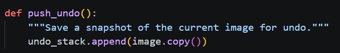
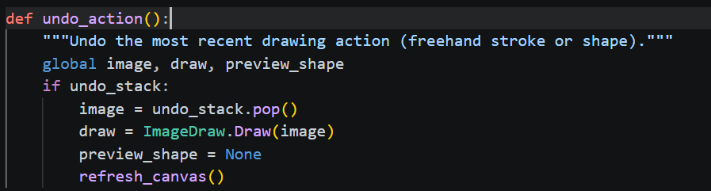
push_undo() saves a backup copy of the drawing before a stroke, shape, clear, or open action.
Clicking Undo runs undo_action(), which brings back the last saved copy on the canvas.

## ✓ Filled Shapes (Rectangles and Ovals)
Before, rectangles and ovals only drew outlines and were always empty inside. I added a fill_shapes setting and a Fill: OFF / ON button so you can fill them with your current color.

Original code:

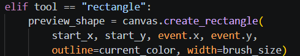

Changed code:
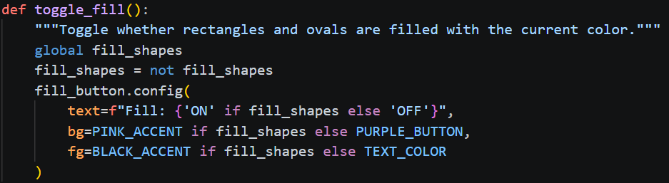
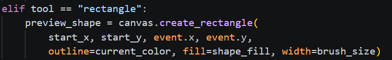
When fill is on, the shape shows its fill color while dragging and saves filled on the final image.

## ✓ Extra Shape Tool (Triangle)
Before, the shape tools only had Line, Rectangle, and Oval. I added a Triangle button and logic to draw and save triangles.

Added code:

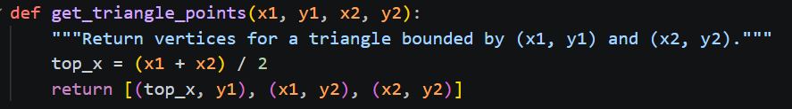
get_triangle_points finds the top middle point and bottom two corners from where you drag.
preview_shape_drawing shows the triangle while dragging, and finish_drawing saves it onto the image.

## ✓ Confirm Before Clearing
Before, clicking Clear erased the whole canvas right away. I added a Yes / No confirmation box first.

Original code:

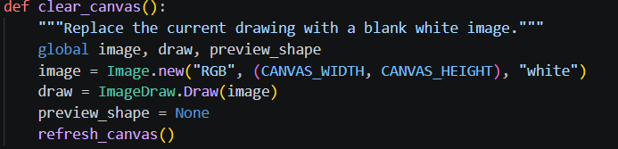

Changed code:
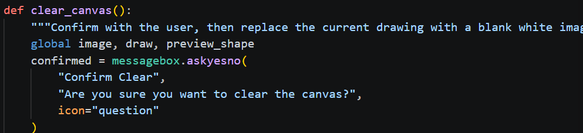

If you click No, it stops and keeps your drawing.

If you click Yes, it saves an undo copy and clears the canvas to white.

## ✓ Quick Colors (Six One-Click Colors)
Before, you had to open the color chooser window every time you wanted a color. I added six quick color buttons—Black, Red, Blue, Green, Yellow, and Purple.

Added code:
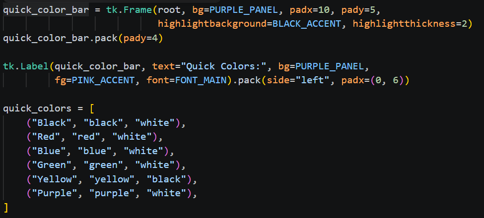
Each button in quick_colors changes current_color right away with one click and updates the color button to match.
